# VOL vs H5Zcomp filter

Inputs:

- chunk: results/vs_vol_60308, results/vs_vol_60309, results/vs_vol_60310, results/vs_vol_60311, results/vs_vol_60312, results/vs_vol_60313, results/vs_vol_60314, results/vs_vol_60315, results/vs_vol_60316
- direct: results/vs_vol_60308, results/vs_vol_60309, results/vs_vol_60310, results/vs_vol_60311
- group: results/vs_vol_60312, results/vs_vol_60313, results/vs_vol_60314, results/vs_vol_60317
- prog_write: results/vs_vol_60325
- vol: /home/kdougherty/hdf5_projs/vol-external-passthrough/tests/results/20260811_140354_52888, /home/kdougherty/hdf5_projs/vol-external-passthrough/tests/results/device_resident_tests
- VOL progressive: /home/kdougherty/hdf5_projs/vol-external-passthrough/tests/results/prog_20260818_140442_53500
- VOL progressive: /home/kdougherty/hdf5_projs/vol-external-passthrough/tests/results/prog_20260818_134437_53492
- VOL progressive: /home/kdougherty/hdf5_projs/vol-external-passthrough/tests/results/prog_20260818_131707_53488

Times are wall clock; write = create+write+flush+sync+close+csync, read = open+read (cold cache). Reps averaged.

## Figure guide

For each figure written by this run: how to read it, then what this run's numbers show. The numbered sections after this one hold the tables behind each figure.

### Ratio parity  (`1_ratio_parity.png`)

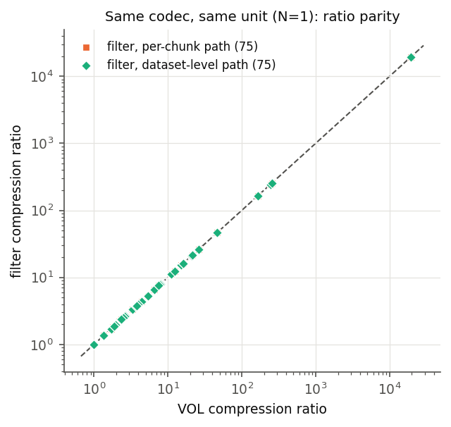

**How to read it.** Each point is one (dataset, codec) pair compressed as a single unit (N=1). The x axis is the VOL's ratio and the y axis is the filter's. Points on the dashed diagonal mean both produced the same compressed size. Orange is the per-chunk filter path, green the dataset-level path.

**What it shows.**

150 pairs over 5 dataset(s) (miranda, nyx_baryon, ocean_temp, s3d, scale-T). Median deviation 0.00%, worst 0.03% (s3d sz3_1e3, direct path). The filter and the VOL produce the same compressed size, so the time differences in the later figures come from the I/O path, not from compressing differently.

### End-to-end time, filter ÷ VOL  (`2_matrix_time.png`)

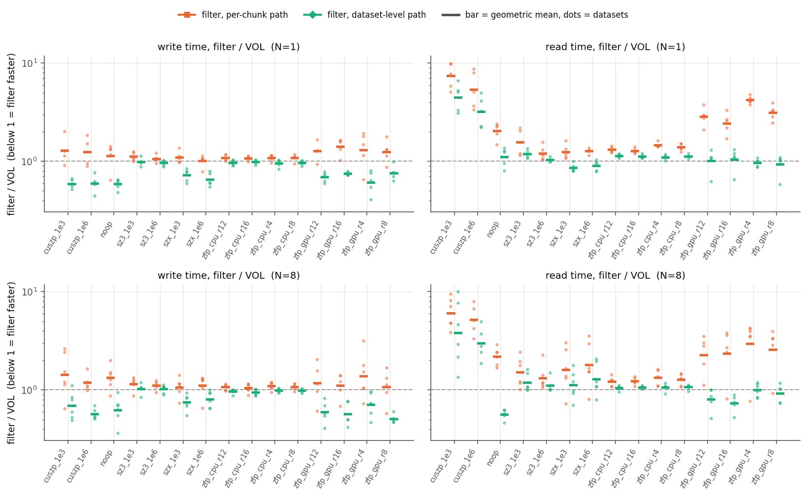

**How to read it.** Top row N=1, bottom row N=8; left write, right read. Each column is a codec, each dot one dataset, and the bar is the geometric mean over datasets. Below the dashed line at 1 the filter is faster. Write covers create through the final fsync, so codec work done at close is counted. Read is open plus read on a cold cache.

**What it shows.**

- N=1 write: filter, per-chunk path 1.17× overall, faster than the VOL for 0/15 codecs, slowest zfp_gpu_r16 (1.42×); filter, dataset-level path 0.77× overall, faster than the VOL for 15/15 codecs, slowest sz3_1e3 (0.99×).
- N=1 read: filter, per-chunk path 2.12× overall, faster than the VOL for 0/15 codecs, slowest cuszp_1e3 (7.42×); filter, dataset-level path 1.24× overall, faster than the VOL for 4/15 codecs, slowest cuszp_1e3 (4.49×).
- N=8 write: filter, per-chunk path 1.16× overall, faster than the VOL for 0/15 codecs, slowest cuszp_1e3 (1.44×); filter, dataset-level path 0.77× overall, faster than the VOL for 13/15 codecs, slowest sz3_1e3 (1.03×).
- N=8 read: filter, per-chunk path 2.04× overall, faster than the VOL for 0/15 codecs, slowest cuszp_1e3 (6.06×); filter, dataset-level path 1.16× overall, faster than the VOL for 4/15 codecs, slowest cuszp_1e3 (3.83×).

The GPU codecs are the outliers on reads at N=1 (cuszp_1e3 7.4× per-chunk / 4.5× dataset-level; cuszp_1e6 5.4× per-chunk / 3.2× dataset-level; zfp_gpu_r12 2.9× per-chunk / 1.0× dataset-level; zfp_gpu_r16 2.4× per-chunk / 1.1× dataset-level; zfp_gpu_r4 4.2× per-chunk / 1.0× dataset-level; zfp_gpu_r8 3.1× per-chunk / 0.9× dataset-level). On the per-chunk path the filter receives host buffers from HDF5's chunk pipeline, so the compressed chunk goes to the device and the result comes back for every call. Any remaining gap on the dataset-level path is cost outside that copy.

### Decoupling storage chunks from compression units: sz3_1e3  (`3_decouple_sz3_1e3.png`)

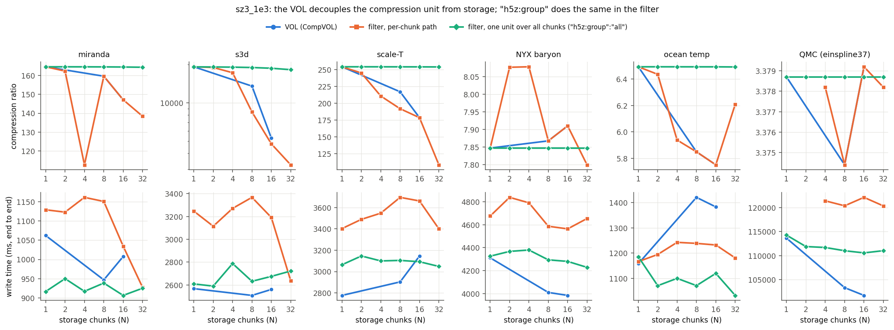

**How to read it.** One column per dataset. Top: compression ratio against the number of storage chunks N. Bottom: end-to-end write time. Blue is the VOL, orange the filter compressing each chunk on its own, and green the filter compressing one unit striped over all N chunks ("h5z:group":"all"). A flat green line in the top row means the ratio no longer depends on how the dataset is chunked.

**What it shows.**

Share of the N=1 compression ratio kept as the dataset is split into more storage chunks (100% = no loss from chunking):

- miranda (N=1 ratio 164.6): VOL 89% at N=16, per-chunk 84% at N=32, group=all 100% at N=32.
- s3d (N=1 ratio 1.92e+04): VOL 27% at N=16, per-chunk 17% at N=32, group=all 95% at N=32.
- scale-T (N=1 ratio 254): VOL 70% at N=16, per-chunk 43% at N=32, group=all 100% at N=32.
- NYX baryon (N=1 ratio 7.847): VOL 101% at N=16, per-chunk 99% at N=32, group=all 100% at N=32.
- ocean temp (N=1 ratio 6.494): VOL 89% at N=16, per-chunk 96% at N=32, group=all 100% at N=32.
- QMC (einspline37) (N=1 ratio 3.379): VOL 100% at N=16, per-chunk 100% at N=32, group=all 100% at N=32.

### Decoupling storage chunks from compression units: szx_1e3  (`3_decouple_szx_1e3.png`)

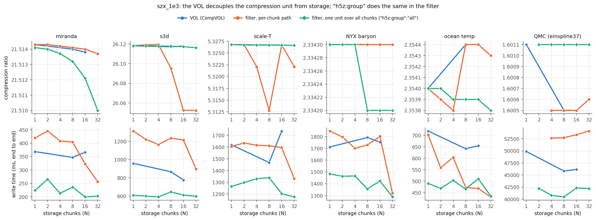

**How to read it.** One column per dataset. Top: compression ratio against the number of storage chunks N. Bottom: end-to-end write time. Blue is the VOL, orange the filter compressing each chunk on its own, and green the filter compressing one unit striped over all N chunks ("h5z:group":"all"). A flat green line in the top row means the ratio no longer depends on how the dataset is chunked.

**What it shows.**

Share of the N=1 compression ratio kept as the dataset is split into more storage chunks (100% = no loss from chunking):

- miranda (N=1 ratio 21.51): VOL 100% at N=16, per-chunk 100% at N=32, group=all 100% at N=32.
- s3d (N=1 ratio 26.12): VOL 100% at N=16, per-chunk 100% at N=32, group=all 100% at N=32.
- scale-T (N=1 ratio 5.327): VOL 100% at N=16, per-chunk 100% at N=32, group=all 100% at N=32.
- NYX baryon (N=1 ratio 2.334): VOL 100% at N=16, per-chunk 100% at N=32, group=all 100% at N=32.
- ocean temp (N=1 ratio 2.354): VOL 100% at N=16, per-chunk 100% at N=32, group=all 100% at N=32.
- QMC (einspline37) (N=1 ratio 1.601): VOL 100% at N=16, per-chunk 100% at N=32, group=all 100% at N=32.

### Decoupling storage chunks from compression units: zfp_cpu_r8  (`3_decouple_zfp_cpu_r8.png`)

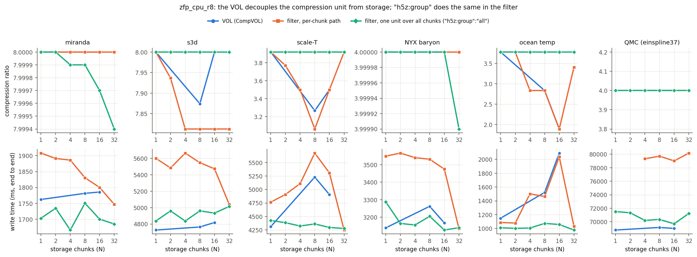

**How to read it.** One column per dataset. Top: compression ratio against the number of storage chunks N. Bottom: end-to-end write time. Blue is the VOL, orange the filter compressing each chunk on its own, and green the filter compressing one unit striped over all N chunks ("h5z:group":"all"). A flat green line in the top row means the ratio no longer depends on how the dataset is chunked.

**What it shows.**

Share of the N=1 compression ratio kept as the dataset is split into more storage chunks (100% = no loss from chunking):

- miranda (N=1 ratio 8): VOL 100% at N=16, per-chunk 100% at N=32, group=all 100% at N=32.
- s3d (N=1 ratio 8): VOL 100% at N=16, per-chunk 98% at N=32, group=all 100% at N=32.
- scale-T (N=1 ratio 3.92): VOL 89% at N=16, per-chunk 100% at N=32, group=all 100% at N=32.
- NYX baryon (N=1 ratio 4): VOL 100% at N=16, per-chunk 100% at N=32, group=all 100% at N=32.
- ocean temp (N=1 ratio 3.778): VOL 50% at N=16, per-chunk 90% at N=32, group=all 100% at N=32.
- QMC (einspline37) (N=1 ratio 4): VOL 100% at N=16, per-chunk 100% at N=32, group=all 100% at N=32.

### Decoupling storage chunks from compression units: cuszp_1e3  (`3_decouple_cuszp_1e3.png`)

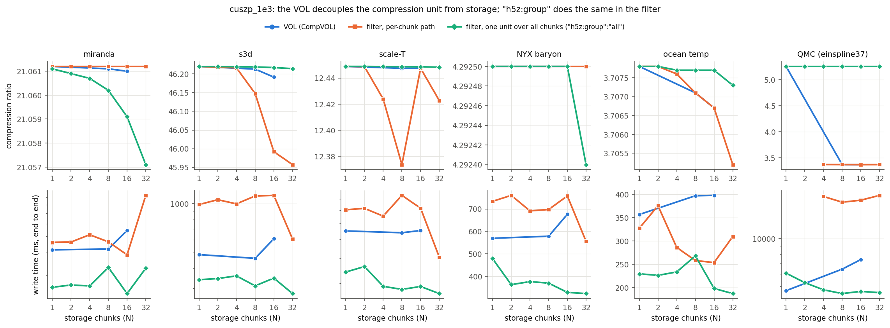

**How to read it.** One column per dataset. Top: compression ratio against the number of storage chunks N. Bottom: end-to-end write time. Blue is the VOL, orange the filter compressing each chunk on its own, and green the filter compressing one unit striped over all N chunks ("h5z:group":"all"). A flat green line in the top row means the ratio no longer depends on how the dataset is chunked.

**What it shows.**

Share of the N=1 compression ratio kept as the dataset is split into more storage chunks (100% = no loss from chunking):

- miranda (N=1 ratio 21.06): VOL 100% at N=16, per-chunk 100% at N=32, group=all 100% at N=32.
- s3d (N=1 ratio 46.22): VOL 100% at N=16, per-chunk 99% at N=32, group=all 100% at N=32.
- scale-T (N=1 ratio 12.45): VOL 100% at N=16, per-chunk 100% at N=32, group=all 100% at N=32.
- NYX baryon (N=1 ratio 4.293): VOL 100% at N=16, per-chunk 100% at N=32, group=all 100% at N=32.
- ocean temp (N=1 ratio 3.708): VOL 100% at N=16, per-chunk 100% at N=32, group=all 100% at N=32.
- QMC (einspline37) (N=1 ratio 5.258): VOL 64% at N=16, per-chunk 64% at N=32, group=all 100% at N=32.

### Where the input buffer lives: cuszp_1e3  (`4_residency_cuszp_1e3.png`)

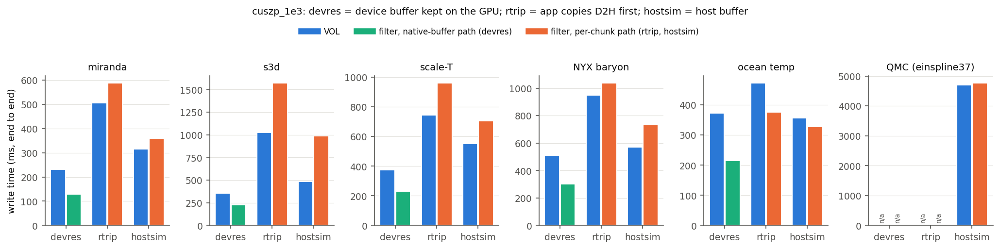

**How to read it.** Write time for the three ways the application can hold its data. In devres the buffer stays on the GPU and is passed through H5Pset_comp_native_buffer. In rtrip the application copies it to the host first. In hostsim it starts on the host. Blue bars are the VOL. The green bar is the filter's native path (devres) and the orange bars its per-chunk path. "n/a" means no row.

**What it shows.**

- miranda: devres 129 ms vs hostsim 359 ms (2.80× slower without the native buffer); filter devres / VOL devres 0.56×.
- s3d: devres 228 ms vs hostsim 989 ms (4.34× slower without the native buffer); filter devres / VOL devres 0.64×.
- scale-T: devres 230 ms vs hostsim 705 ms (3.06× slower without the native buffer); filter devres / VOL devres 0.61×.
- NYX baryon: devres 302 ms vs hostsim 734 ms (2.43× slower without the native buffer); filter devres / VOL devres 0.59×.
- ocean temp: devres 215 ms vs hostsim 327 ms (1.52× slower without the native buffer); filter devres / VOL devres 0.58×.
- QMC (einspline37): hostsim 1.01× the VOL.

### Where the input buffer lives: cuszp_1e6  (`4_residency_cuszp_1e6.png`)

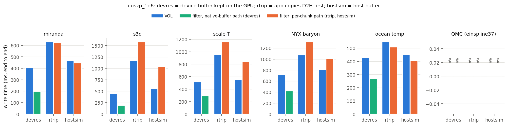

**How to read it.** Write time for the three ways the application can hold its data. In devres the buffer stays on the GPU and is passed through H5Pset_comp_native_buffer. In rtrip the application copies it to the host first. In hostsim it starts on the host. Blue bars are the VOL. The green bar is the filter's native path (devres) and the orange bars its per-chunk path. "n/a" means no row.

**What it shows.**

- miranda: devres 198 ms vs hostsim 445 ms (2.24× slower without the native buffer); filter devres / VOL devres 0.49×.
- s3d: devres 191 ms vs hostsim 1039 ms (5.43× slower without the native buffer); filter devres / VOL devres 0.43×.
- scale-T: devres 290 ms vs hostsim 839 ms (2.90× slower without the native buffer); filter devres / VOL devres 0.56×.
- NYX baryon: devres 419 ms vs hostsim 1013 ms (2.42× slower without the native buffer); filter devres / VOL devres 0.59×.
- ocean temp: devres 269 ms vs hostsim 405 ms (1.51× slower without the native buffer); filter devres / VOL devres 0.63×.

### Where the input buffer lives: zfp_gpu_r12  (`4_residency_zfp_gpu_r12.png`)

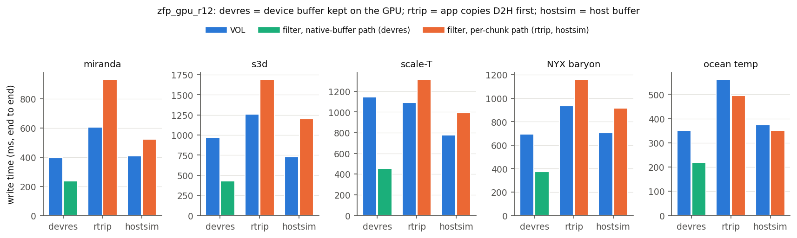

**How to read it.** Write time for the three ways the application can hold its data. In devres the buffer stays on the GPU and is passed through H5Pset_comp_native_buffer. In rtrip the application copies it to the host first. In hostsim it starts on the host. Blue bars are the VOL. The green bar is the filter's native path (devres) and the orange bars its per-chunk path. "n/a" means no row.

**What it shows.**

- miranda: devres 235 ms vs hostsim 523 ms (2.22× slower without the native buffer); filter devres / VOL devres 0.60×.
- s3d: devres 429 ms vs hostsim 1204 ms (2.81× slower without the native buffer); filter devres / VOL devres 0.44×.
- scale-T: devres 457 ms vs hostsim 994 ms (2.18× slower without the native buffer); filter devres / VOL devres 0.40×.
- NYX baryon: devres 373 ms vs hostsim 917 ms (2.46× slower without the native buffer); filter devres / VOL devres 0.54×.
- ocean temp: devres 220 ms vs hostsim 352 ms (1.60× slower without the native buffer); filter devres / VOL devres 0.63×.

### Where the input buffer lives: zfp_gpu_r16  (`4_residency_zfp_gpu_r16.png`)

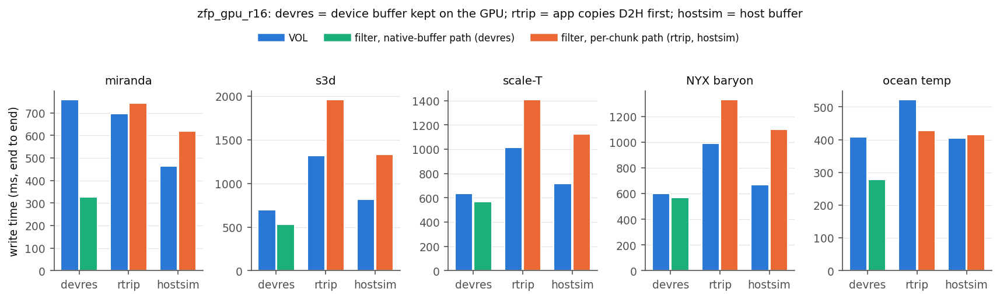

**How to read it.** Write time for the three ways the application can hold its data. In devres the buffer stays on the GPU and is passed through H5Pset_comp_native_buffer. In rtrip the application copies it to the host first. In hostsim it starts on the host. Blue bars are the VOL. The green bar is the filter's native path (devres) and the orange bars its per-chunk path. "n/a" means no row.

**What it shows.**

- miranda: devres 327 ms vs hostsim 619 ms (1.89× slower without the native buffer); filter devres / VOL devres 0.43×.
- s3d: devres 533 ms vs hostsim 1333 ms (2.50× slower without the native buffer); filter devres / VOL devres 0.76×.
- scale-T: devres 570 ms vs hostsim 1126 ms (1.97× slower without the native buffer); filter devres / VOL devres 0.90×.
- NYX baryon: devres 570 ms vs hostsim 1100 ms (1.93× slower without the native buffer); filter devres / VOL devres 0.95×.
- ocean temp: devres 277 ms vs hostsim 415 ms (1.49× slower without the native buffer); filter devres / VOL devres 0.68×.

### Where the input buffer lives: zfp_gpu_r4  (`4_residency_zfp_gpu_r4.png`)

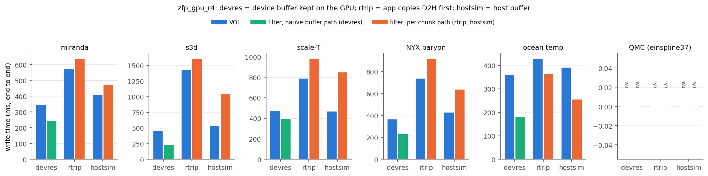

**How to read it.** Write time for the three ways the application can hold its data. In devres the buffer stays on the GPU and is passed through H5Pset_comp_native_buffer. In rtrip the application copies it to the host first. In hostsim it starts on the host. Blue bars are the VOL. The green bar is the filter's native path (devres) and the orange bars its per-chunk path. "n/a" means no row.

**What it shows.**

- miranda: devres 245 ms vs hostsim 474 ms (1.94× slower without the native buffer); filter devres / VOL devres 0.71×.
- s3d: devres 238 ms vs hostsim 1042 ms (4.37× slower without the native buffer); filter devres / VOL devres 0.51×.
- scale-T: devres 400 ms vs hostsim 852 ms (2.13× slower without the native buffer); filter devres / VOL devres 0.84×.
- NYX baryon: devres 232 ms vs hostsim 641 ms (2.76× slower without the native buffer); filter devres / VOL devres 0.63×.
- ocean temp: devres 181 ms vs hostsim 257 ms (1.42× slower without the native buffer); filter devres / VOL devres 0.50×.

### Where the input buffer lives: zfp_gpu_r8  (`4_residency_zfp_gpu_r8.png`)

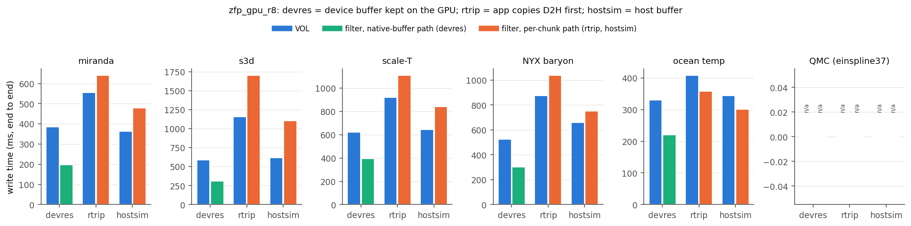

**How to read it.** Write time for the three ways the application can hold its data. In devres the buffer stays on the GPU and is passed through H5Pset_comp_native_buffer. In rtrip the application copies it to the host first. In hostsim it starts on the host. Blue bars are the VOL. The green bar is the filter's native path (devres) and the orange bars its per-chunk path. "n/a" means no row.

**What it shows.**

- miranda: devres 198 ms vs hostsim 479 ms (2.43× slower without the native buffer); filter devres / VOL devres 0.51×.
- s3d: devres 308 ms vs hostsim 1102 ms (3.58× slower without the native buffer); filter devres / VOL devres 0.52×.
- scale-T: devres 394 ms vs hostsim 841 ms (2.13× slower without the native buffer); filter devres / VOL devres 0.63×.
- NYX baryon: devres 301 ms vs hostsim 751 ms (2.49× slower without the native buffer); filter devres / VOL devres 0.58×.
- ocean temp: devres 220 ms vs hostsim 301 ms (1.37× slower without the native buffer); filter devres / VOL devres 0.67×.

### Progressive (truncated) reads  (`5_progressive.png`)

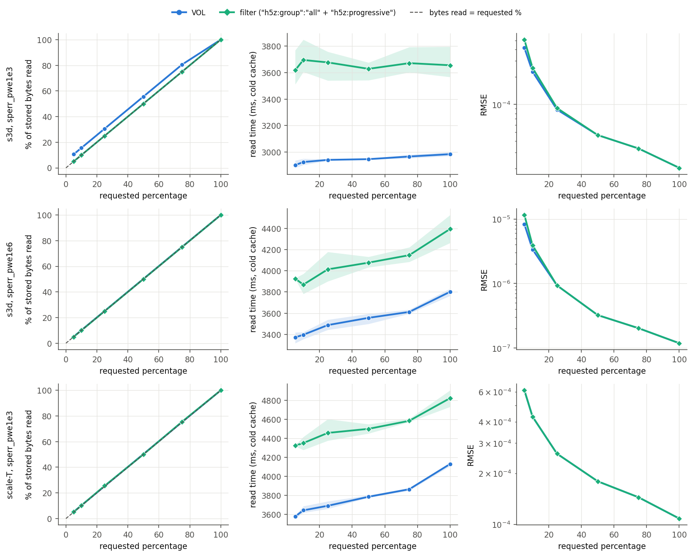

**How to read it.** One row per (dataset, codec). Left: share of stored bytes actually read against the requested percentage (the dashed diagonal is an exact match). Middle: read time on a cold cache, with the band showing the min–max over reps. Right: RMSE of the reconstruction (log scale). On the left, closer to the diagonal is better; in the middle, lower is faster; on the right, overlapping lines mean the same reconstruction quality at that percentage.

**What it shows.**

- s3d sperr_pwe1e3: largest gap between bytes read and the requested percentage is VOL +5.6 points, filter +0.0 points. RMSE matches the VOL within 1% from 50% upward. Filter read time is 1.23–1.26× the VOL's, and goes from 3618 to 3656 ms between 5% and 100%.
- s3d sperr_pwe1e6: largest gap between bytes read and the requested percentage is VOL +0.1 points, filter +0.0 points. RMSE matches the VOL within 1% from 25% upward. Filter read time is 1.14–1.16× the VOL's, and goes from 3927 to 4393 ms between 5% and 100%.
- scale-T sperr_pwe1e3: largest gap between bytes read and the requested percentage is VOL +0.3 points, filter +0.5 points. RMSE matches the VOL within 1% from 5% upward. Filter read time is 1.17–1.21× the VOL's, and goes from 4324 to 4823 ms between 5% and 100%.

If read time barely changes with the percentage, the fixed costs (opening the file, setting up the codec, decoding at least the coarse levels) dominate at these sizes. Truncation is then saving I/O bytes rather than wall time.

## 1. Ratio parity (N=1)

150 pairs; median |filter/VOL - 1| = 0.00%, worst 0.03%.

| path | dataset | codec | VOL ratio | filter ratio |
|---|---|---|---|---|
| chunk | s3d | sz3_1e3 | 19195.33 | 19201.23 |
| direct | s3d | sz3_1e3 | 19195.33 | 19201.23 |
| chunk | ocean_temp | zfp_cpu_r4 | 7.56 | 7.56 |
| chunk | ocean_temp | zfp_gpu_r4 | 7.56 | 7.56 |
| direct | ocean_temp | zfp_cpu_r4 | 7.56 | 7.56 |

## 2. Filter / VOL time (geometric mean over datasets)

| N | codec | write chunk | write direct | read chunk | read direct |
|---|---|---|---|---|---|
| 1 | cuszp_1e3 | 1.29 | 0.59 | 7.42 | 4.49 |
| 1 | cuszp_1e6 | 1.25 | 0.60 | 5.37 | 3.21 |
| 1 | noop | 1.14 | 0.59 | 2.04 | 1.11 |
| 1 | sz3_1e3 | 1.12 | 0.99 | 1.58 | 1.19 |
| 1 | sz3_1e6 | 1.07 | 0.96 | 1.21 | 1.04 |
| 1 | szx_1e3 | 1.10 | 0.72 | 1.26 | 0.86 |
| 1 | szx_1e6 | 1.01 | 0.66 | 1.27 | 0.91 |
| 1 | zfp_cpu_r12 | 1.09 | 0.97 | 1.32 | 1.14 |
| 1 | zfp_cpu_r16 | 1.08 | 0.99 | 1.28 | 1.12 |
| 1 | zfp_cpu_r4 | 1.09 | 0.96 | 1.47 | 1.11 |
| 1 | zfp_cpu_r8 | 1.09 | 0.97 | 1.39 | 1.13 |
| 1 | zfp_gpu_r12 | 1.27 | 0.69 | 2.85 | 1.01 |
| 1 | zfp_gpu_r16 | 1.42 | 0.75 | 2.44 | 1.05 |
| 1 | zfp_gpu_r4 | 1.31 | 0.61 | 4.22 | 0.97 |
| 1 | zfp_gpu_r8 | 1.25 | 0.76 | 3.14 | 0.93 |
| 8 | cuszp_1e3 | 1.44 | 0.70 | 6.06 | 3.83 |
| 8 | cuszp_1e6 | 1.19 | 0.57 | 5.23 | 2.98 |
| 8 | noop | 1.33 | 0.63 | 2.20 | 0.57 |
| 8 | sz3_1e3 | 1.16 | 1.03 | 1.52 | 1.19 |
| 8 | sz3_1e6 | 1.11 | 1.02 | 1.32 | 1.12 |
| 8 | szx_1e3 | 1.07 | 0.75 | 1.61 | 1.12 |
| 8 | szx_1e6 | 1.11 | 0.81 | 1.80 | 1.29 |
| 8 | zfp_cpu_r12 | 1.07 | 0.97 | 1.22 | 1.05 |
| 8 | zfp_cpu_r16 | 1.05 | 0.95 | 1.23 | 1.07 |
| 8 | zfp_cpu_r4 | 1.10 | 0.99 | 1.34 | 1.07 |
| 8 | zfp_cpu_r8 | 1.08 | 0.99 | 1.27 | 1.07 |
| 8 | zfp_gpu_r12 | 1.17 | 0.60 | 2.28 | 0.81 |
| 8 | zfp_gpu_r16 | 1.11 | 0.57 | 2.36 | 0.73 |
| 8 | zfp_gpu_r4 | 1.38 | 0.71 | 2.97 | 1.00 |
| 8 | zfp_gpu_r8 | 1.07 | 0.51 | 2.59 | 0.93 |

## 3. Decoupling: ratio vs number of storage chunks

**sz3_1e3**

| dataset | N | VOL ratio | filter per-chunk | filter group=all |
|---|---|---|---|---|
| miranda | 1 | 164.57 | 164.57 | 164.56 |
| miranda | 2 | - | 162.29 | 164.56 |
| miranda | 4 | - | 112.72 | 164.54 |
| miranda | 8 | 159.59 | 159.59 | 164.51 |
| miranda | 16 | 147.11 | 147.12 | 164.44 |
| miranda | 32 | - | 138.43 | 164.32 |
| s3d | 1 | 19195.33 | 19201.23 | 19168.84 |
| s3d | 2 | - | 18962.38 | 19136.56 |
| s3d | 4 | - | 17239.30 | 19072.32 |
| s3d | 8 | 13524.66 | 8470.63 | 18945.13 |
| s3d | 16 | 5274.76 | 4752.81 | 18695.78 |
| s3d | 32 | - | 3249.62 | 18216.26 |
| scale-T | 1 | 254.02 | 254.03 | 254.02 |
| scale-T | 2 | - | 244.74 | 254.01 |
| scale-T | 4 | - | 210.56 | 253.99 |
| scale-T | 8 | 216.88 | 191.72 | 253.95 |
| scale-T | 16 | 178.46 | 178.47 | 253.88 |
| scale-T | 32 | - | 108.42 | 253.77 |
| nyx_baryon | 1 | 7.85 | 7.85 | 7.85 |
| nyx_baryon | 2 | - | 8.08 | 7.85 |
| nyx_baryon | 4 | - | 8.08 | 7.85 |
| nyx_baryon | 8 | 7.87 | 7.87 | 7.85 |
| nyx_baryon | 16 | 7.91 | 7.91 | 7.85 |
| nyx_baryon | 32 | - | 7.80 | 7.85 |
| ocean_temp | 1 | 6.49 | 6.49 | 6.49 |
| ocean_temp | 2 | - | 6.44 | 6.49 |
| ocean_temp | 4 | - | 5.94 | 6.49 |
| ocean_temp | 8 | 5.85 | 5.85 | 6.49 |
| ocean_temp | 16 | 5.75 | 5.75 | 6.49 |
| ocean_temp | 32 | - | 6.21 | 6.49 |
| einspline37 | 1 | 3.38 | - | 3.38 |
| einspline37 | 2 | - | - | 3.38 |
| einspline37 | 4 | - | 3.38 | 3.38 |
| einspline37 | 8 | 3.37 | 3.37 | 3.38 |
| einspline37 | 16 | 3.38 | 3.38 | 3.38 |
| einspline37 | 32 | - | 3.38 | 3.38 |

**szx_1e3**

| dataset | N | VOL ratio | filter per-chunk | filter group=all |
|---|---|---|---|---|
| miranda | 1 | 21.51 | 21.51 | 21.51 |
| miranda | 2 | - | 21.51 | 21.51 |
| miranda | 4 | - | 21.51 | 21.51 |
| miranda | 8 | 21.51 | 21.51 | 21.51 |
| miranda | 16 | 21.51 | 21.51 | 21.51 |
| miranda | 32 | - | 21.51 | 21.51 |
| s3d | 1 | 26.12 | 26.12 | 26.12 |
| s3d | 2 | - | 26.12 | 26.12 |
| s3d | 4 | - | 26.12 | 26.12 |
| s3d | 8 | 26.12 | 26.10 | 26.12 |
| s3d | 16 | 26.12 | 26.05 | 26.12 |
| s3d | 32 | - | 26.05 | 26.12 |
| scale-T | 1 | 5.33 | 5.33 | 5.33 |
| scale-T | 2 | - | 5.33 | 5.33 |
| scale-T | 4 | - | 5.32 | 5.33 |
| scale-T | 8 | 5.33 | 5.31 | 5.33 |
| scale-T | 16 | 5.33 | 5.33 | 5.33 |
| scale-T | 32 | - | 5.32 | 5.33 |
| nyx_baryon | 1 | 2.33 | 2.33 | 2.33 |
| nyx_baryon | 2 | - | 2.33 | 2.33 |
| nyx_baryon | 4 | - | 2.33 | 2.33 |
| nyx_baryon | 8 | 2.33 | 2.33 | 2.33 |
| nyx_baryon | 16 | 2.33 | 2.33 | 2.33 |
| nyx_baryon | 32 | - | 2.33 | 2.33 |
| ocean_temp | 1 | 2.35 | 2.35 | 2.35 |
| ocean_temp | 2 | - | 2.35 | 2.35 |
| ocean_temp | 4 | - | 2.35 | 2.35 |
| ocean_temp | 8 | 2.35 | 2.35 | 2.35 |
| ocean_temp | 16 | 2.35 | 2.35 | 2.35 |
| ocean_temp | 32 | - | 2.35 | 2.35 |
| einspline37 | 1 | 1.60 | - | - |
| einspline37 | 2 | - | - | 1.60 |
| einspline37 | 4 | - | 1.60 | 1.60 |
| einspline37 | 8 | 1.60 | 1.60 | 1.60 |
| einspline37 | 16 | 1.60 | 1.60 | 1.60 |
| einspline37 | 32 | - | 1.60 | 1.60 |

**zfp_cpu_r8**

| dataset | N | VOL ratio | filter per-chunk | filter group=all |
|---|---|---|---|---|
| miranda | 1 | 8.00 | 8.00 | 8.00 |
| miranda | 2 | - | 8.00 | 8.00 |
| miranda | 4 | - | 8.00 | 8.00 |
| miranda | 8 | 8.00 | 8.00 | 8.00 |
| miranda | 16 | 8.00 | 8.00 | 8.00 |
| miranda | 32 | - | 8.00 | 8.00 |
| s3d | 1 | 8.00 | 8.00 | 8.00 |
| s3d | 2 | - | 7.94 | 8.00 |
| s3d | 4 | - | 7.81 | 8.00 |
| s3d | 8 | 7.87 | 7.81 | 8.00 |
| s3d | 16 | 8.00 | 7.81 | 8.00 |
| s3d | 32 | - | 7.81 | 8.00 |
| scale-T | 1 | 3.92 | 3.92 | 3.92 |
| scale-T | 2 | - | 3.77 | 3.92 |
| scale-T | 4 | - | 3.50 | 3.92 |
| scale-T | 8 | 3.27 | 3.06 | 3.92 |
| scale-T | 16 | 3.50 | 3.50 | 3.92 |
| scale-T | 32 | - | 3.92 | 3.92 |
| nyx_baryon | 1 | 4.00 | 4.00 | 4.00 |
| nyx_baryon | 2 | - | 4.00 | 4.00 |
| nyx_baryon | 4 | - | 4.00 | 4.00 |
| nyx_baryon | 8 | 4.00 | 4.00 | 4.00 |
| nyx_baryon | 16 | 4.00 | 4.00 | 4.00 |
| nyx_baryon | 32 | - | 4.00 | 4.00 |
| ocean_temp | 1 | 3.78 | 3.78 | 3.78 |
| ocean_temp | 2 | - | 3.78 | 3.78 |
| ocean_temp | 4 | - | 2.83 | 3.78 |
| ocean_temp | 8 | 2.83 | 2.83 | 3.78 |
| ocean_temp | 16 | 1.89 | 1.89 | 3.78 |
| ocean_temp | 32 | - | 3.40 | 3.78 |
| einspline37 | 1 | 4.00 | - | 4.00 |
| einspline37 | 2 | - | - | 4.00 |
| einspline37 | 4 | - | 4.00 | 4.00 |
| einspline37 | 8 | 4.00 | 4.00 | 4.00 |
| einspline37 | 16 | 4.00 | 4.00 | 4.00 |
| einspline37 | 32 | - | 4.00 | 4.00 |

**cuszp_1e3**

| dataset | N | VOL ratio | filter per-chunk | filter group=all |
|---|---|---|---|---|
| miranda | 1 | 21.06 | 21.06 | 21.06 |
| miranda | 2 | - | 21.06 | 21.06 |
| miranda | 4 | - | 21.06 | 21.06 |
| miranda | 8 | 21.06 | 21.06 | 21.06 |
| miranda | 16 | 21.06 | 21.06 | 21.06 |
| miranda | 32 | - | 21.06 | 21.06 |
| s3d | 1 | 46.22 | 46.22 | 46.22 |
| s3d | 2 | - | 46.22 | 46.22 |
| s3d | 4 | - | 46.22 | 46.22 |
| s3d | 8 | 46.21 | 46.15 | 46.22 |
| s3d | 16 | 46.19 | 45.99 | 46.22 |
| s3d | 32 | - | 45.96 | 46.21 |
| scale-T | 1 | 12.45 | 12.45 | 12.45 |
| scale-T | 2 | - | 12.45 | 12.45 |
| scale-T | 4 | - | 12.42 | 12.45 |
| scale-T | 8 | 12.45 | 12.37 | 12.45 |
| scale-T | 16 | 12.45 | 12.45 | 12.45 |
| scale-T | 32 | - | 12.42 | 12.45 |
| nyx_baryon | 1 | 4.29 | 4.29 | 4.29 |
| nyx_baryon | 2 | - | 4.29 | 4.29 |
| nyx_baryon | 4 | - | 4.29 | 4.29 |
| nyx_baryon | 8 | 4.29 | 4.29 | 4.29 |
| nyx_baryon | 16 | 4.29 | 4.29 | 4.29 |
| nyx_baryon | 32 | - | 4.29 | 4.29 |
| ocean_temp | 1 | 3.71 | 3.71 | 3.71 |
| ocean_temp | 2 | - | 3.71 | 3.71 |
| ocean_temp | 4 | - | 3.71 | 3.71 |
| ocean_temp | 8 | 3.71 | 3.71 | 3.71 |
| ocean_temp | 16 | 3.71 | 3.71 | 3.71 |
| ocean_temp | 32 | - | 3.71 | 3.71 |
| einspline37 | 1 | 5.26 | - | 5.26 |
| einspline37 | 2 | - | - | 5.26 |
| einspline37 | 4 | - | 3.37 | 5.26 |
| einspline37 | 8 | 3.37 | 3.37 | 5.26 |
| einspline37 | 16 | 3.37 | 3.37 | 5.26 |
| einspline37 | 32 | - | 3.37 | 5.26 |

## 4. Residency arms: end-to-end write time (ms)

| codec | dataset | arm | VOL | filter | filter / VOL |
|---|---|---|---|---|---|
| cuszp_1e3 | miranda | devres | 231.0 | 128.5 | 0.56 |
| cuszp_1e3 | miranda | rtrip | 505.4 | 587.9 | 1.16 |
| cuszp_1e3 | miranda | hostsim | 314.6 | 359.4 | 1.14 |
| cuszp_1e3 | s3d | devres | 358.2 | 227.7 | 0.64 |
| cuszp_1e3 | s3d | rtrip | 1024.3 | 1572.3 | 1.54 |
| cuszp_1e3 | s3d | hostsim | 485.4 | 988.6 | 2.04 |
| cuszp_1e3 | scale-T | devres | 374.7 | 230.0 | 0.61 |
| cuszp_1e3 | scale-T | rtrip | 744.6 | 961.3 | 1.29 |
| cuszp_1e3 | scale-T | hostsim | 550.9 | 704.6 | 1.28 |
| cuszp_1e3 | nyx_baryon | devres | 511.0 | 302.0 | 0.59 |
| cuszp_1e3 | nyx_baryon | rtrip | 950.1 | 1038.0 | 1.09 |
| cuszp_1e3 | nyx_baryon | hostsim | 569.6 | 733.7 | 1.29 |
| cuszp_1e3 | ocean_temp | devres | 372.3 | 214.9 | 0.58 |
| cuszp_1e3 | ocean_temp | rtrip | 472.9 | 376.9 | 0.80 |
| cuszp_1e3 | ocean_temp | hostsim | 356.9 | 327.3 | 0.92 |
| cuszp_1e3 | einspline37 | hostsim | 4703.8 | 4765.8 | 1.01 |
| cuszp_1e6 | miranda | devres | 401.9 | 198.2 | 0.49 |
| cuszp_1e6 | miranda | rtrip | 629.6 | 619.8 | 0.98 |
| cuszp_1e6 | miranda | hostsim | 463.3 | 444.8 | 0.96 |
| cuszp_1e6 | s3d | devres | 441.0 | 191.4 | 0.43 |
| cuszp_1e6 | s3d | rtrip | 1167.9 | 1577.6 | 1.35 |
| cuszp_1e6 | s3d | hostsim | 559.6 | 1038.5 | 1.86 |
| cuszp_1e6 | scale-T | devres | 513.8 | 289.8 | 0.56 |
| cuszp_1e6 | scale-T | rtrip | 953.3 | 1155.9 | 1.21 |
| cuszp_1e6 | scale-T | hostsim | 553.3 | 839.2 | 1.52 |
| cuszp_1e6 | nyx_baryon | devres | 710.5 | 419.2 | 0.59 |
| cuszp_1e6 | nyx_baryon | rtrip | 1074.6 | 1311.7 | 1.22 |
| cuszp_1e6 | nyx_baryon | hostsim | 813.0 | 1012.9 | 1.25 |
| cuszp_1e6 | ocean_temp | devres | 428.4 | 269.2 | 0.63 |
| cuszp_1e6 | ocean_temp | rtrip | 547.0 | 507.4 | 0.93 |
| cuszp_1e6 | ocean_temp | hostsim | 452.1 | 405.4 | 0.90 |
| zfp_gpu_r12 | miranda | devres | 394.5 | 235.5 | 0.60 |
| zfp_gpu_r12 | miranda | rtrip | 605.2 | 933.9 | 1.54 |
| zfp_gpu_r12 | miranda | hostsim | 407.7 | 523.3 | 1.28 |
| zfp_gpu_r12 | s3d | devres | 972.6 | 428.8 | 0.44 |
| zfp_gpu_r12 | s3d | rtrip | 1260.2 | 1693.7 | 1.34 |
| zfp_gpu_r12 | s3d | hostsim | 726.7 | 1203.8 | 1.66 |
| zfp_gpu_r12 | scale-T | devres | 1143.2 | 456.7 | 0.40 |
| zfp_gpu_r12 | scale-T | rtrip | 1092.8 | 1315.3 | 1.20 |
| zfp_gpu_r12 | scale-T | hostsim | 777.4 | 993.6 | 1.28 |
| zfp_gpu_r12 | nyx_baryon | devres | 693.3 | 372.6 | 0.54 |
| zfp_gpu_r12 | nyx_baryon | rtrip | 933.9 | 1161.6 | 1.24 |
| zfp_gpu_r12 | nyx_baryon | hostsim | 706.4 | 916.9 | 1.30 |
| zfp_gpu_r12 | ocean_temp | devres | 351.7 | 220.0 | 0.63 |
| zfp_gpu_r12 | ocean_temp | rtrip | 562.0 | 495.7 | 0.88 |
| zfp_gpu_r12 | ocean_temp | hostsim | 374.4 | 351.9 | 0.94 |
| zfp_gpu_r16 | miranda | devres | 758.6 | 326.7 | 0.43 |
| zfp_gpu_r16 | miranda | rtrip | 696.2 | 743.9 | 1.07 |
| zfp_gpu_r16 | miranda | hostsim | 462.9 | 618.5 | 1.34 |
| zfp_gpu_r16 | s3d | devres | 699.4 | 532.7 | 0.76 |
| zfp_gpu_r16 | s3d | rtrip | 1322.7 | 1961.4 | 1.48 |
| zfp_gpu_r16 | s3d | hostsim | 814.9 | 1332.8 | 1.64 |
| zfp_gpu_r16 | scale-T | devres | 635.2 | 570.2 | 0.90 |
| zfp_gpu_r16 | scale-T | rtrip | 1016.9 | 1408.6 | 1.39 |
| zfp_gpu_r16 | scale-T | hostsim | 718.0 | 1125.6 | 1.57 |
| zfp_gpu_r16 | nyx_baryon | devres | 600.1 | 570.2 | 0.95 |
| zfp_gpu_r16 | nyx_baryon | rtrip | 989.6 | 1331.9 | 1.35 |
| zfp_gpu_r16 | nyx_baryon | hostsim | 668.9 | 1100.0 | 1.64 |
| zfp_gpu_r16 | ocean_temp | devres | 408.1 | 277.5 | 0.68 |
| zfp_gpu_r16 | ocean_temp | rtrip | 522.0 | 427.9 | 0.82 |
| zfp_gpu_r16 | ocean_temp | hostsim | 404.4 | 414.5 | 1.03 |
| zfp_gpu_r4 | miranda | devres | 347.2 | 244.9 | 0.71 |
| zfp_gpu_r4 | miranda | rtrip | 572.7 | 638.1 | 1.11 |
| zfp_gpu_r4 | miranda | hostsim | 410.9 | 473.9 | 1.15 |
| zfp_gpu_r4 | s3d | devres | 464.9 | 238.3 | 0.51 |
| zfp_gpu_r4 | s3d | rtrip | 1431.6 | 1608.7 | 1.12 |
| zfp_gpu_r4 | s3d | hostsim | 540.1 | 1042.0 | 1.93 |
| zfp_gpu_r4 | scale-T | devres | 475.5 | 400.3 | 0.84 |
| zfp_gpu_r4 | scale-T | rtrip | 792.0 | 982.5 | 1.24 |
| zfp_gpu_r4 | scale-T | hostsim | 471.3 | 851.7 | 1.81 |
| zfp_gpu_r4 | nyx_baryon | devres | 366.8 | 231.8 | 0.63 |
| zfp_gpu_r4 | nyx_baryon | rtrip | 740.4 | 918.5 | 1.24 |
| zfp_gpu_r4 | nyx_baryon | hostsim | 430.5 | 640.9 | 1.49 |
| zfp_gpu_r4 | ocean_temp | devres | 361.6 | 181.3 | 0.50 |
| zfp_gpu_r4 | ocean_temp | rtrip | 428.9 | 364.7 | 0.85 |
| zfp_gpu_r4 | ocean_temp | hostsim | 391.7 | 257.0 | 0.66 |
| zfp_gpu_r8 | miranda | devres | 384.7 | 197.5 | 0.51 |
| zfp_gpu_r8 | miranda | rtrip | 554.9 | 640.6 | 1.15 |
| zfp_gpu_r8 | miranda | hostsim | 363.7 | 479.3 | 1.32 |
| zfp_gpu_r8 | s3d | devres | 588.0 | 307.6 | 0.52 |
| zfp_gpu_r8 | s3d | rtrip | 1159.6 | 1702.6 | 1.47 |
| zfp_gpu_r8 | s3d | hostsim | 619.2 | 1102.3 | 1.78 |
| zfp_gpu_r8 | scale-T | devres | 624.1 | 394.2 | 0.63 |
| zfp_gpu_r8 | scale-T | rtrip | 922.1 | 1110.8 | 1.20 |
| zfp_gpu_r8 | scale-T | hostsim | 645.8 | 841.0 | 1.30 |
| zfp_gpu_r8 | nyx_baryon | devres | 523.5 | 301.3 | 0.58 |
| zfp_gpu_r8 | nyx_baryon | rtrip | 875.0 | 1038.4 | 1.19 |
| zfp_gpu_r8 | nyx_baryon | hostsim | 659.4 | 750.7 | 1.14 |
| zfp_gpu_r8 | ocean_temp | devres | 330.3 | 220.2 | 0.67 |
| zfp_gpu_r8 | ocean_temp | rtrip | 408.0 | 357.3 | 0.88 |
| zfp_gpu_r8 | ocean_temp | hostsim | 343.8 | 301.2 | 0.88 |

## 5. Progressive reads

| dataset | codec | pct | VOL bytes read | filter bytes read | VOL read ms | filter read ms | VOL RMSE | filter RMSE |
|---|---|---|---|---|---|---|---|---|
| s3d | sperr_pwe1e3 | 5 | 10.6% | 5.0% | 2901 | 3618 | 4.157e-04 | 5.104e-04 |
| s3d | sperr_pwe1e3 | 10 | 15.6% | 10.0% | 2924 | 3695 | 2.281e-04 | 2.513e-04 |
| s3d | sperr_pwe1e3 | 25 | 30.6% | 25.0% | 2941 | 3677 | 8.799e-05 | 9.149e-05 |
| s3d | sperr_pwe1e3 | 50 | 55.6% | 50.0% | 2946 | 3628 | 4.638e-05 | 4.638e-05 |
| s3d | sperr_pwe1e3 | 75 | 80.6% | 75.0% | 2966 | 3671 | 3.314e-05 | 3.314e-05 |
| s3d | sperr_pwe1e3 | 100 | 100.0% | 100.0% | 2984 | 3656 | 2.036e-05 | 2.036e-05 |
| s3d | sperr_pwe1e6 | 5 | 5.1% | 5.0% | 3372 | 3927 | 8.305e-06 | 1.154e-05 |
| s3d | sperr_pwe1e6 | 10 | 10.1% | 10.0% | 3397 | 3869 | 3.374e-06 | 3.923e-06 |
| s3d | sperr_pwe1e6 | 25 | 25.1% | 25.0% | 3488 | 4013 | 9.352e-07 | 9.352e-07 |
| s3d | sperr_pwe1e6 | 50 | 50.1% | 50.0% | 3556 | 4076 | 3.243e-07 | 3.243e-07 |
| s3d | sperr_pwe1e6 | 75 | 75.1% | 75.0% | 3612 | 4147 | 2.034e-07 | 2.034e-07 |
| s3d | sperr_pwe1e6 | 100 | 100.0% | 100.0% | 3802 | 4393 | 1.191e-07 | 1.191e-07 |
| scale-T | sperr_pwe1e3 | 5 | 5.3% | 5.1% | 3577 | 4324 | 6.120e-04 | 6.120e-04 |
| scale-T | sperr_pwe1e3 | 10 | 10.3% | 10.2% | 3642 | 4350 | 4.289e-04 | 4.289e-04 |
| scale-T | sperr_pwe1e3 | 25 | 25.3% | 25.5% | 3690 | 4457 | 2.602e-04 | 2.602e-04 |
| scale-T | sperr_pwe1e3 | 50 | 50.3% | 50.0% | 3785 | 4500 | 1.793e-04 | 1.793e-04 |
| scale-T | sperr_pwe1e3 | 75 | 75.3% | 75.5% | 3864 | 4585 | 1.446e-04 | 1.446e-04 |
| scale-T | sperr_pwe1e3 | 100 | 100.0% | 100.0% | 4129 | 4823 | 1.085e-04 | 1.085e-04 |

## Recorded failures (rep=-1)

einspline37 at N=1 is expected to fail: the whole dataset as one HDF5 chunk is over the 4 GiB chunk limit, so the harness records it and moves on. Any other row here is a real failure; the matching `stdout_*` log in the job folder has the error.

- chunk: einspline37 cuszp_1e3 N=1 hostsim
- chunk: einspline37 cuszp_1e3 N=2 hostsim
- chunk: einspline37 cuszp_1e6 N=1 hostsim
- chunk: einspline37 cuszp_1e6 N=8 hostsim
- chunk: einspline37 cuszp_1e6 N=16 hostsim
- chunk: einspline37 noop N=1 hostsim
- chunk: einspline37 sz3_1e3 N=1 hostsim
- chunk: einspline37 sz3_1e3 N=2 hostsim
- chunk: einspline37 sz3_1e6 N=1 hostsim
- chunk: einspline37 szx_1e3 N=1 hostsim
- chunk: einspline37 szx_1e3 N=2 hostsim
- chunk: einspline37 szx_1e6 N=1 hostsim
- chunk: einspline37 zfp_cpu_r12 N=1 hostsim
- chunk: einspline37 zfp_cpu_r16 N=1 hostsim
- chunk: einspline37 zfp_cpu_r4 N=1 hostsim
- chunk: einspline37 zfp_cpu_r8 N=1 hostsim
- chunk: einspline37 zfp_cpu_r8 N=2 hostsim
- chunk: einspline37 zfp_gpu_r12 N=1 hostsim
- chunk: einspline37 zfp_gpu_r12 N=8 hostsim
- chunk: einspline37 zfp_gpu_r12 N=16 hostsim
- chunk: einspline37 zfp_gpu_r16 N=1 hostsim
- chunk: einspline37 zfp_gpu_r16 N=8 hostsim
- chunk: einspline37 zfp_gpu_r16 N=16 hostsim
- chunk: einspline37 zfp_gpu_r4 N=1 hostsim
- chunk: einspline37 zfp_gpu_r8 N=1 hostsim
- chunk: einspline37 zfp_gpu_r8 N=8 hostsim
- direct: einspline37 cuszp_1e3 N=1 hostsim
- direct: einspline37 cuszp_1e6 N=1 hostsim
- direct: einspline37 cuszp_1e6 N=8 hostsim
- direct: einspline37 cuszp_1e6 N=16 hostsim
- direct: einspline37 noop N=1 hostsim
- direct: einspline37 sz3_1e3 N=1 hostsim
- direct: einspline37 sz3_1e6 N=1 hostsim
- direct: einspline37 szx_1e3 N=1 hostsim
- direct: einspline37 szx_1e6 N=1 hostsim
- direct: einspline37 zfp_cpu_r12 N=1 hostsim
- direct: einspline37 zfp_cpu_r16 N=1 hostsim
- direct: einspline37 zfp_cpu_r4 N=1 hostsim
- direct: einspline37 zfp_cpu_r8 N=1 hostsim
- direct: einspline37 zfp_gpu_r12 N=1 hostsim
- direct: einspline37 zfp_gpu_r12 N=8 hostsim
- direct: einspline37 zfp_gpu_r12 N=16 hostsim
- direct: einspline37 zfp_gpu_r16 N=1 hostsim
- direct: einspline37 zfp_gpu_r16 N=8 hostsim
- direct: einspline37 zfp_gpu_r16 N=16 hostsim
- direct: einspline37 zfp_gpu_r4 N=1 hostsim
- direct: einspline37 zfp_gpu_r8 N=1 hostsim
- direct: einspline37 zfp_gpu_r8 N=8 hostsim
- group: einspline37 cuszp_1e3 N=4 devres
- group: einspline37 cuszp_1e3 N=4 rtrip
- group: einspline37 cuszp_1e6 N=4 devres
- group: einspline37 cuszp_1e6 N=4 hostsim
- group: einspline37 cuszp_1e6 N=4 rtrip
- group: einspline37 szx_1e3 N=1 hostsim
- group: einspline37 zfp_gpu_r12 N=4 devres
- group: einspline37 zfp_gpu_r12 N=4 hostsim
- group: einspline37 zfp_gpu_r12 N=4 rtrip
- group: einspline37 zfp_gpu_r16 N=4 devres
- group: einspline37 zfp_gpu_r16 N=4 hostsim
- group: einspline37 zfp_gpu_r16 N=4 rtrip
- group: einspline37 zfp_gpu_r4 N=4 devres
- group: einspline37 zfp_gpu_r4 N=4 hostsim
- group: einspline37 zfp_gpu_r4 N=4 rtrip
- group: einspline37 zfp_gpu_r8 N=4 devres
- group: einspline37 zfp_gpu_r8 N=4 hostsim
- group: einspline37 zfp_gpu_r8 N=4 rtrip

